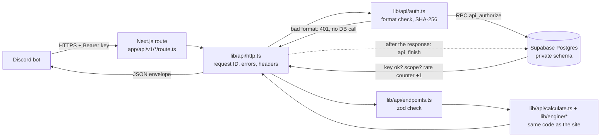

# Forge Calculator API: technical handoff

The site has a small public API so Discord bots and other fan tools can use the same game data and maths as the calculator.
This folder explains how it works and how to run it. Start here, then:

| Document | For | What's in it |
| --- | --- | --- |
| [setup.md](setup.md) | The site owner | Turning the API on in Supabase, the admin account, the dashboard, making a key, testing, monitoring, rotating keys, troubleshooting |
| [discord-handoff.md](discord-handoff.md) | The bot developer | Both endpoints, example JSON, the `/forge-calc` commands, autocomplete, quality buttons |
| [maths.md](maths.md) | Anyone checking numbers | Dark Knight's Gauntlets worked through by hand, from ores to DPS |
| [validation.md](validation.md) | Reviewers | What was tested and how, and what's still to check on the live site |

The public page for developers is [/developers](https://the-forge-calculator.vercel.app/developers) and the machine-readable
spec is [/developers/openapi.json](https://the-forge-calculator.vercel.app/developers/openapi.json).

## What the API does

| Endpoint | Needs | Returns |
| --- | --- | --- |
| `GET /api/v1/catalogue` | a key with `catalogue:read` (during the beta) | Ores, weapons, armour, classes and odds, races, runes, molds, Golemites, pickaxes. Filters: `type`, `world`, `ids`, `search`. ETag/304. |
| `POST /api/v1/calculate` | a key with `calculator:execute` | One of four calculations picked by `type`: `forge`, `dps`, `loadout`, `golemite`. |

Default limits: 60 catalogue requests and 120 calculations a minute per key. The admin can change both per key.

## How a request flows

1. **The route** (`app/api/v1/catalogue/route.ts`, `app/api/v1/calculate/route.ts`) only connects Next.js to the shared handler.
2. **`handle()`** gives every request an ID (`req_…`), turns any error into the standard error body, adds rate-limit headers, and schedules the usage log to be written after the response has gone out.
3. **The key** is read from `Authorization: Bearer …`. Anything that isn't `fc_live_` plus 43 characters is refused straight away, without touching the database. A well-formed key is hashed with SHA-256; only the hash is sent to the database.
4. **`api_authorize`** (one database call) checks the IP lock-out, finds the key by hash, checks it isn't revoked or expired and has the right permission, adds one to that key's counter for this minute, and opens a log row. The counter is a single `insert … on conflict do update set hits = hits + 1 returning hits`, so two servers can never both take the last request.
5. **The work**: the body is checked with zod (`lib/api/schema.ts`), then the same engine the calculator page uses runs (`lib/engine/forge-eval.ts` and friends).
6. **`api_finish`** records the status and time taken in the log row. It needs a one-time token from step 4, so nobody can write to the log directly.

## Security in one list

- Keys are 256 random bits, shown once, stored only as a SHA-256 hash. The first characters (`fc_live_AbCd…`) are kept so the dashboard can tell keys apart.
- All API tables live in the `private` schema, which Supabase doesn't expose. Row level security is on and every grant is removed. The only way in is through functions that check who is calling.
- Admin functions check the caller's account ID against `private.api_admins`. The display name is never used: renaming another account to "1920m" gets nothing (there's a test for that).
- Wrong keys: 20 from one address within 10 minutes locks that address out for 10 minutes. The address is stored hashed.
- The usage log keeps the key ID, endpoint, status, time taken and error code. Never the key, the request body or the IP.
- Clean-up runs inside normal requests (at most once every 10 minutes): rate counters older than 10 minutes, wrong-key counts older than an hour and log rows older than 30 days are deleted. Nothing else is touched.

## Files

| File | What it does |
| --- | --- |
| `app/api/v1/catalogue/route.ts`, `app/api/v1/calculate/route.ts` | The two routes. Node runtime, never cached, 10-second limit. |
| `lib/api/http.ts` | `handle()`: request IDs, errors, headers, the after-response log. `readJson()`: content type, 16 KB limit, JSON parsing. |
| `lib/api/auth.ts` | Key format, hashing, IP hashing, and the database authorizer (4-second timeout, failures become 503). |
| `lib/api/endpoints.ts` | The endpoint logic, independent of Next.js so the tests can call it with a fake key store. ETag for the catalogue. |
| `lib/api/schema.ts` | zod schemas for every request. The OpenAPI spec is generated from them. |
| `lib/api/catalogue.ts` | Builds the public catalogue: stable IDs, worlds, traits with what they apply to, `null` for unknowns. |
| `lib/api/calculate.ts` | The four calculations and their warnings. Works out the world when it isn't sent. |
| `lib/api/errors.ts` | Every error code with its HTTP status and message. |
| `lib/api/version.ts` | `apiVersion`, `calculationModelVersion` and `dataVersion`. |
| `lib/api/deps.ts` | Connects the endpoints to the real database, Next.js `after()` and the catalogue loader. |
| `lib/api/openapi.ts`, `app/developers/openapi.json/route.ts` | The OpenAPI 3.1 spec. |
| `lib/api/docs.ts`, `app/developers/page.tsx` | The public developer page. Its examples are run through the real engine when the page is built. |
| `lib/api/admin.ts`, `components/api-dashboard.tsx`, `app/developers/dashboard/page.tsx` | The admin dashboard. |
| `lib/engine/forge-eval.ts` | Forge logic shared by the calculator page and the API (lock, molds, which item is shown). |
| `supabase/migrations/20261104100000_public_api.sql` | Tables, the admin row, and every database function. |
| `supabase/tests/*` | Database tests: security rules, clean-up, and a 200-request race on the rate limit. |
| `tests/api.test.ts`, `tests/api-admin.test.ts`, `tests/api-docs.test.ts` | Unit tests for the endpoints, dashboard helpers, spec, docs examples and the example client. |
| `public/developers/examples/*` | The TypeScript and Python clients and the two Discord examples. |

## Versions

Every response says which data and maths produced it:

- `apiVersion` (`v1`): changes only if the request or response shape breaks.
- `catalogueRevision`: the game-data release from Supabase. It goes up when ores, weapons or odds are updated.
- `dataVersion`: a short hash of the data bundled with the site (races, runes, molds, Golemites). It changes when a deploy changes them.
- `calculationModelVersion` (`2026-11-04`): bump it in `lib/api/version.ts` whenever a formula changes, so bot owners can tell why a number moved.

## Final handoff checklist

| # | Topic | Where |
| --- | --- | --- |
| 1 | Supabase key system setup | [setup.md § 1](setup.md#1-turn-the-api-on-in-supabase) |
| 2 | Admin configuration | [setup.md § 2](setup.md#2-the-admin-account) |
| 3 | Dashboard access | [setup.md § 3](setup.md#3-the-dashboard) |
| 4 | Creating the friend's key | [setup.md § 4](setup.md#4-make-a-key-for-a-bot) |
| 5 | How both endpoints work | [discord-handoff.md § 1](discord-handoff.md#1-the-two-endpoints) |
| 6 | Example JSON | [discord-handoff.md § 2](discord-handoff.md#2-example-json) |
| 7 | Bot usage per endpoint | [discord-handoff.md § 3](discord-handoff.md#3-the-forge-calc-command) |
| 8 | Autocomplete | [discord-handoff.md § 4](discord-handoff.md#4-autocomplete) |
| 9 | Quality-button recalculation | [discord-handoff.md § 5](discord-handoff.md#5-quality-buttons) |
| 10 | Testing locally and on Vercel | [setup.md § 5](setup.md#5-testing) |
| 11 | Monitoring, rotation and troubleshooting | [setup.md § 6–8](setup.md#6-monitoring) |
| 12 | Technical breakdown | This page, and [maths.md](maths.md) |
